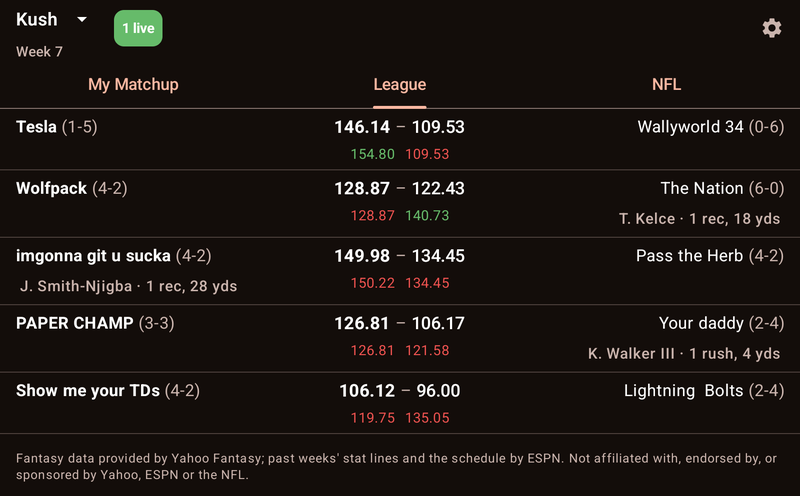
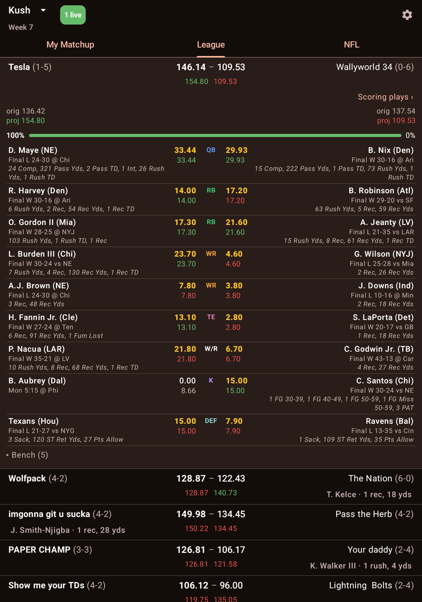
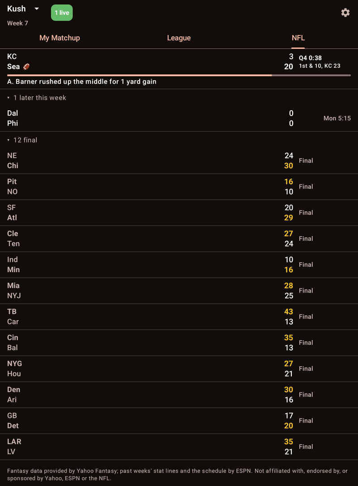
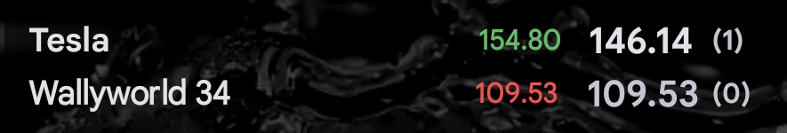
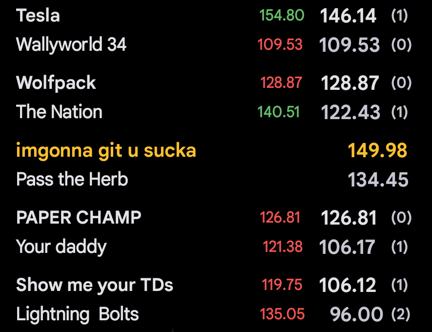

# FFL Live — Yahoo Fantasy Football for Android

Live Yahoo Fantasy Football scoring on your phone: your matchup, every matchup in the league, and the
NFL slate, with the play that last moved each score. A native Android port of
[ha-ffl-yahoo](https://github.com/johnbr/ha-ffl-yahoo), with no Home Assistant needed.

**All it needs is your league id.** It needs no Yahoo account, sign-in, API key or approval. Private
leagues work too.

## Features

- **Three tabs.**
  - **My Matchup** shows your team against your opponent. Under it are the NFL games in progress that
    a starter on either side is playing in.
  - **League** shows every matchup, with the live NFL game below them when only one is on.
  - **NFL** shows the week's games: live ones first, today's next, and the rest folded under "later this
    week" and "final".
- **Live points and projections.** Each team shows its season record after its name (`Tesla (0-4)`),
  its current points and its live projection. The projection is coloured against the morning's number.
- **Per-matchup scoring plays.** Under each matchup is the play that last moved *that* score,
  aligned to the side that scored it. Bench points never count. Tap the line for the matchup's full
  scoring history, or tap the matchup for both lineups and a win probability. Once no starter is
  playing the line is gone, and "Scoring plays ›" in the lineup opens the history instead.
- **A player's season.** Tap a player (or a defence) in a lineup for his season, week by week: the
  opponent or bye, Yahoo's projection, and the points he scored, with the weeks still to come projected
  against their opponents. "‹ Lineup" goes back.
- **The NFL games.**
  - Each game shows its clock, down and distance, possession, a red-zone badge and a field bar.
  - Every game has its play list.
  - A TOUCHDOWN / FIELD GOAL / SAFETY banner stays up until the next play lands.
  - A provisional result (`Gain of 7, 1st down`) appears while Yahoo's sentence is still on its way.
- **Live mode (opt-in).** A foreground service keeps scores current with the app closed.
  - It starts itself shortly before kickoff and stops when the games are over.
  - It sends alerts for *my player scored*, *opponent scored* and *lead changed*.
  - A notification is updated in place when the play's text lands.
- **Home-screen widget.** Your matchup, drawn like the integration's my-score card.
  - Both scores and live projections (green above the morning's projection, red below), with the
    decimal points lined up.
  - After each score, how many of that team's starters still have a game to finish, in progress or
    yet to kick off: `111.74 (3)`.
  - The last play, for three minutes after it scores. Two rows tall, the play gets two lines.
  - Once the matchup is over, the projections and counts drop away and the winner turns gold.
- **League widget.** Every matchup in the league stacked, each drawn as the matchup widget draws
  yours, with the decimal points lined up down the stack. A stack a little too tall for the widget
  tightens its gaps and then drops its play lines to fit; a much taller one scrolls.
  Tap a matchup to open it in the app with its lineup showing: yours on My Matchup, any other on
  League.
- **Several leagues.** Switch from the title bar.

<table>
  <tr>
    <td valign="top" width="33%">
      
      <br><sub><b>League</b>: every matchup, with the play that last moved its score.</sub>
    </td>
    <td valign="top" width="33%">
      
      <br><sub><b>Tap a matchup</b> for both lineups and the win probability.</sub>
    </td>
    <td valign="top" width="33%">
      
      <br><sub><b>NFL</b>: live games first, the rest folded under "later this week" and "final".</sub>
    </td>
  </tr>
</table>

<table>
  <tr>
    <td valign="top" width="50%">
      
      <br><sub><b>Matchup widget</b>: your score, live projections and starters left to play.</sub>
    </td>
    <td valign="top" width="50%">
      
      <br><sub><b>League widget</b>: every matchup; a finished one turns its winner gold.</sub>
    </td>
  </tr>
</table>

## How it gets the data

It reads Yahoo's **GameChannel** tier, the same anonymous endpoints `sports.yahoo.com/nfl/gamechannel/`
runs on:

- `pub-api.fantasysports.yahoo.com/fantasy/v3/redzone/nfl?league_id=…` provides teams, rosters,
  matchups, projections and your league's own scoring settings. It is cached for 3 minutes.
- `relay-stream.sports.yahoo.com/nfl/{stats,games}.txt` is the live tier. It is polled every 10 s
  while a rostered player's game is on, every 5 minutes near games and every 30 minutes otherwise.
  Leagues share these fetches.
- `relay-stream.sports.yahoo.com/nfl/plays-<id>.txt` gives play-by-play for live games. It is fetched
  with `If-Modified-Since`, so an unchanged feed costs a `304`.

A player's season also reads the same league seed with `&week=N` for each week's projections (a
finished week's are kept, so they are fetched once), and ESPN's public fantasy API
(`lm-api-reads.fantasy.espn.com`, also anonymous) for each player's weekly stat lines and the NFL
schedule. Yahoo publishes no per-week fantasy points without a login, so a finished week's points are
ESPN's line scored with your league's modifiers. Checked against week 5 of 2026: 115 of 115 players to
the cent. The first player opened costs about twenty requests; after that it is cached.

**The points are computed, not read.** Yahoo publishes no live fantasy totals on this tier. The app
multiplies each player's live stat line by your league's scoring modifiers, as Yahoo's own page does.
Scoring plays come from diffing consecutive polls. "Real time" means 30–60 seconds, because that is how
far Yahoo's own live scoring trails the play. See the
[integration's README](https://github.com/johnbr/ha-ffl-yahoo#worth-knowing) for the details:
stat corrections, plays that arrive in pieces, the relay's overnight restart, and held feeds.

## Install

Download the APK from the [latest release](https://github.com/johnbr/ffl-yahoo-android/releases/latest)
and open it on your phone. You will need to allow installing from your browser or file manager.
Android 8.0 or newer is required.

To get updates automatically, add `https://github.com/johnbr/ffl-yahoo-android` to
[Obtainium](https://github.com/ImranR98/Obtainium).

On first launch, paste your league id or the league's URL. The id is `802904` in
`https://football.fantasysports.yahoo.com/f1/802904`. Then pick your team.

## Development

```
core/   pure Kotlin/JVM: the engine (parsers, scoring, play synthesis, pending plays, banners,
        state shaping, the polling engine), ported from the integration's Python
app/    Android: Compose UI, live-mode service, notifications, Glance widget
tools/  parity_dump.py, which writes the golden files the engine is tested against
```

```bash
./gradlew :core:test                    # engine tests, no Android SDK needed (add -PcoreOnly without one)
./gradlew :app:lintDebug :app:assembleDebug
```

The engine is held to the integration's own behaviour. `tools/parity_dump.py` runs the integration's
Python over the shared fixtures, and through 60 scripted polls of a live game driven through its real
coordinator. It writes `core/src/test/resources/golden/`, and `StaticParityTest` and
`ScenarioParityTest` require identical output. After a deliberate change to the integration,
regenerate the golden files:

```bash
python3 tools/parity_dump.py --ha-repo ../ha-ffl-yahoo
```

Versions are managed by [release-please](https://github.com/googleapis/release-please) from
conventional commits. A release builds a signed APK and attaches it.

## Attribution

Fantasy data provided by Yahoo Fantasy. Past weeks' player stat lines and the NFL schedule come from
ESPN. This project is not affiliated with, endorsed by, or sponsored by Yahoo, ESPN or the NFL.

## License

[MIT](LICENSE)
